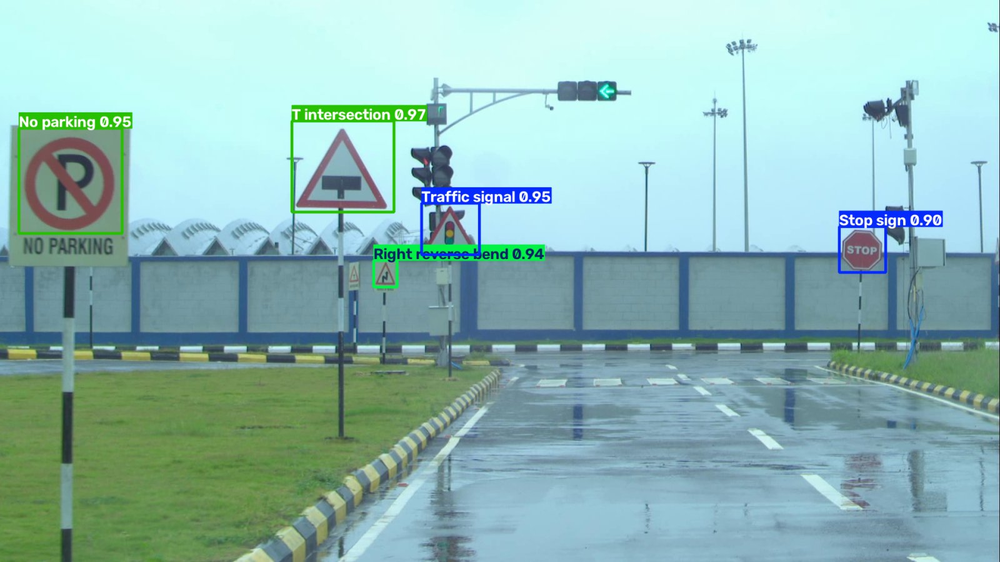
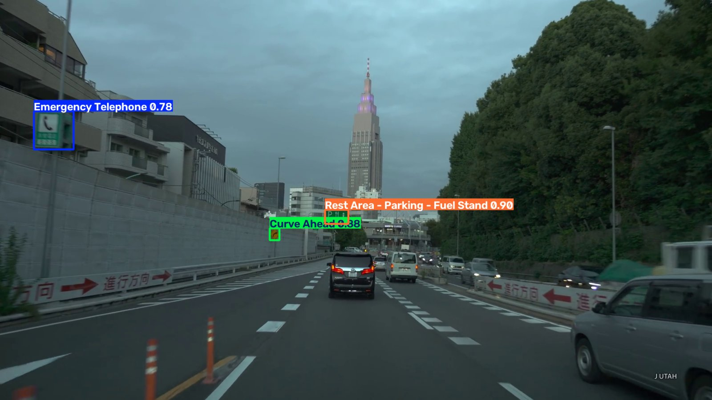
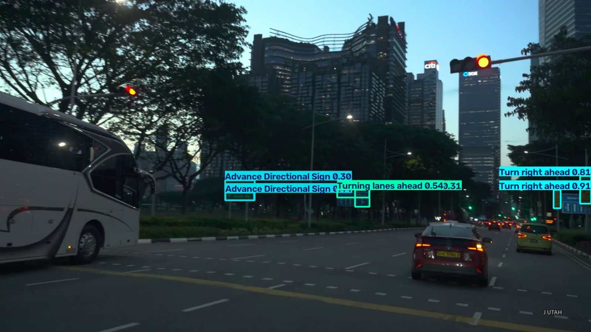
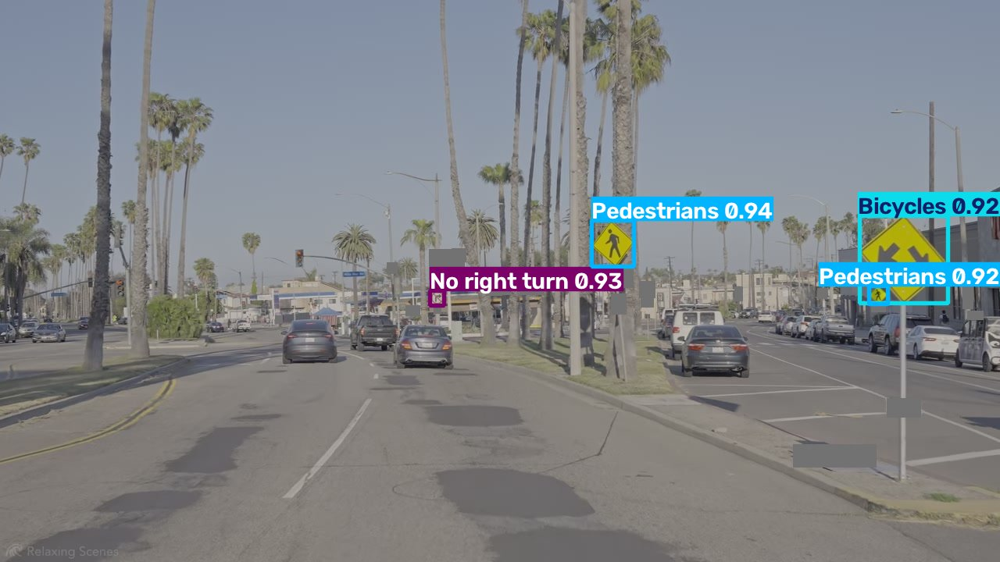

# Traffic-Sign Detection for India, Japan, Singapore and USA

YOLO11 traffic-sign detectors built for the four countries' official rule books, one model per country.
Every sign in each country's handbook is a class. Training data is real dash-cam / drive footage,
auto-boxed with open-vocabulary detection, checked by eye, and balanced with synthetic sign pastes
only where real images are missing.

| Country | Classes | Final model | Input size | Real-frame test mAP50 | mAP50-95 |
|---|---|---|---|---|---|
| India | 101 (+ hidden "Other sign") | YOLO11s, `india_v3` | 1280 | 0.901 | 0.763 |
| Japan | 120 | YOLO11s, `jp_signs_v2` + per-class thresholds | 1920 | 0.924 | 0.830 |
| Singapore | 159 | YOLO11s, `sg_signs_v2` | 1920 (trained on 640 tiles) | 0.871 * | 0.815 * |
| USA | 209 (+ hidden "Other sign") | YOLO11s, `us_signs_v3` | 1920 | 0.940 | 0.855 |

\* Singapore figures are on the real-only validation tiles. The others are on full-size held-out road frames.
Full tables, benchmarks and per-country notes: [RESULTS.txt](RESULTS.txt).
Pipeline and design: [ARCHITECTURE.md](ARCHITECTURE.md).

## Sample results

| India (test bed) | Japan |
|---|---|
|  |  |
| **Singapore** | **USA** |
|  |  |

Each image in `sample_results/<country>/` has a `.txt` next to it listing every detection (class, confidence, box).
The frames are held-out frames, never used for training.

## Repository layout

```
india/       India pipeline: inventory, templates from the handbook, auto-labelling, cleaning,
             test-bed video mining, training v1-v3, benchmark of 8 detectors (rescore_job.sh)
japan/       Japan pipeline: class map, template extraction, auto-box, balanced set, training, threshold calibration
singapore/   Singapore pipeline: same steps + hard-negative and video fine-tuning, 512x288 real-time model
usa/         USA pipeline: same steps + MTSD mapping, synthetic "Other sign" class, video review (v4)
sample_results/  annotated example frames + detection lists per country
```

Main scripts in every country folder (names are shared):

| Step | Script |
|---|---|
| Class list from the rule book | `make_class_map.py`, `classes.txt`, `class_map.yaml/json` |
| Sign templates from the handbook | `extract_templates.py` (India: `make_templates.py`) |
| Auto-boxing of real frames | `autobox_real.py` (OWLv2 boxes + DINOv2 / YOLO class score), `autolabel.py` |
| Label checking | `audit_labels.py`, `shape_check.py`, `crosscheck_yolo.py`, `relabel_round2.py` |
| Balanced dataset + synthetic pastes | `build_balanced_dataset.py`, `make_backgrounds.py`, `make_train_split.py` |
| Training (SLURM) | `lr_check_job.sh`, `full_train_job.sh` / `train_v*_job.sh`, `train_v2.py` |
| Evaluation | `eval_full.py` (full frames), `calibrate_thresholds.py`, India `rescore_job.sh` |
| Video inference | `detect.py`, `video_job.sh`, `mine_video.py` |

## Setup

```bash
conda create -n signs python=3.11 -y && conda activate signs
pip install -r requirements.txt
```

Tested with Python 3.11, PyTorch 2.5.1 + CUDA 12.1 and Ultralytics 8.4.174 on NVIDIA A40 / H200 (SLURM).

## Usage

Run a trained model on a video (weights are not in this repo, see below):

```bash
python usa/detect.py drive.mp4 us_signs_v3_best.pt out/      # source  weights  [out_dir]
```

`source` can be an image, a folder of images or a video. Videos are tracked (ByteTrack) so signs do not
flicker, and per-class thresholds from `thresholds.json` are used when present.

Train (example, USA):

```bash
sbatch usa/lr_check_job.sh       # picks the learning rate (0.005 was best in all 4 countries)
sbatch usa/train_v3_job.sh       # full run with early stopping, real-only validation
```

The SLURM scripts use absolute paths from our HPC (`/data/common_datasets/...`) and a conda env path.
Change those to your own paths before running.

## Not included

- **Datasets and videos:** too large for git, and part of the footage is third-party
  (YouTube drive videos, nuScenes, Mapillary MTSD under CC BY-NC-SA). Only the code that builds the datasets is here.
- **Trained weights** (`*.pt`, about 20 MB each): available on request / as a release later.

## Status

India paper in preparation (IEEE format). Authors and licence to be added.
